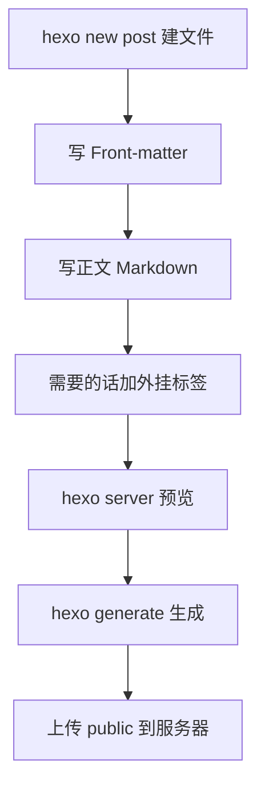

写文章就三件事：**文件头写什么、正文怎么写、用什么标签更好看**。
这一篇把三件事一次性讲完，每段都配了可以直接复制的示例。


**关于本文里的加空格写法**：下面凡是**展示语法**的地方，标签都写成 `{ % xxx % }`（花括号和百分号之间有空格），这是为了防止被提前解析。你实际使用时把空格全部删掉，连写成正常标签即可。凡是**展示效果**的地方用的都是真实标签。


## 一、文件头（Front-matter）

每篇文章最顶部被 `---` 包起来的那段叫 Front-matter，写的是这篇文章的"身份证"。

```yaml
---
title: 文章标题                  # 必填，显示的文章名
date: 2026-10-22 15:00:00        # 发布时间
updated: 2026-10-22 15:00:00     # 更新时间（可省略）
categories:                      # 分类，只能有一个
  - 开始使用
tags:                            # 标签，可以有多个
  - Hexo
  - 写作
cover: /assets/cover/cover-001.svg   # 封面图
description: 一句话摘要          # 列表页和轮播里显示的那句话
swiper_index: 11                 # 上首页轮播，数字越大越靠前，不写就不上
sticky: 1                        # 置顶，数字越大越靠前，不写不置顶
comments: true                   # 是否开启评论
toc: true                        # 是否显示右侧目录
mathjax: true                    # 需要数学公式时开
password: 123456                 # 文章加密密码，不写不加密
---
```


`abbrlink`（文章链接后缀）由插件自动生成，**不用手写**。`updated` 不写的话会取文件修改时间。


## 二、Markdown 基础语法

### 标题

```markdown
# 一级标题
## 二级标题
### 三级标题
#### 四级标题
```

### 强调

```markdown
**加粗**  *斜体*  ~~删除线~~  ==高亮==  `行内代码`
```

效果：**加粗** *斜体* ~~删除线~~ ==高亮== `行内代码`

### 列表

```markdown
- 无序列表项
- 无序列表项
  - 嵌套一项

1. 有序列表项
2. 有序列表项

- [x] 已完成的任务
- [ ] 未完成的任务
```

效果：

- 无序列表项
- 无序列表项
  - 嵌套一项

1. 有序列表项
2. 有序列表项

- [x] 已完成的任务
- [ ] 未完成的任务

### 引用

```markdown
> 这是一段引用
> 可以写多行
```

> 这是一段引用
> 可以写多行

### 链接与图片

```markdown
[文字链接](https://example.com)


```

### 表格

```markdown
| 材料 | 每刀深 | 进给 | 转速 |
| :--- | :---: | ---: | --- |
| 铝合金 | 3-5mm | 120 | 1800 |
| 45 钢 | 2-3mm | 80 | 900 |
| 不锈钢 | 1-2mm | 50 | 500 |
```

| 材料 | 每刀深 | 进给 | 转速 |
| :--- | :---: | ---: | --- |
| 铝合金 | 3-5mm | 120 | 1800 |
| 45 钢 | 2-3mm | 80 | 900 |
| 不锈钢 | 1-2mm | 50 | 500 |

冒号控制对齐：`:---` 左对齐，`---:` 右对齐，`:---:` 居中。

### 分割线

```markdown
---
```

---

### 摘要截断

在正文里想要截断的位置插入 `<!-- more -->`，列表页就只显示它前面的内容。

```markdown
这是摘要部分，列表页只显示到这里。

<!-- more -->

这是正文，要点进文章才看得到。
```

## 三、代码块

用三个反引号包起来，后面写语言名即可高亮：

````markdown
```gcode
O0001
G21 G90 G40
G54 G00 X0 Y0
M03 S1200
G01 Z-2 F100
M30
```
````

效果：

```gcode
O0001
G21 G90 G40
G54 G00 X0 Y0
M03 S1200
G01 Z-2 F100
M30
```

常用语言标识：`gcode` `nc` `python` `javascript` `bash` `yaml` `json` `html` `css` `c` `java`


Front-matter 用的是 YAML 格式，**冒号后面必须有空格**，写成 `title:xxx` 会解析失败。


## 四、本主题专属外挂标签

这些是 Fomalhaut 主题自带的增强标签，普通 Markdown 没有，用起来更好看。

### 提示框 note


```markdown
{ % note default % }
默认提示
{ % endnote % }

{ % note primary % }
主要提示
{ % endnote % }

{ % note success % }
操作成功
{ % endnote % }

{ % note info % }
这是一条信息
{ % endnote % }

{ % note warning % }
注意这里
{ % endnote % }

{ % note danger % }
危险操作
{ % endnote % }
```


效果：


默认提示



主要提示



操作成功



这是一条信息



注意这里



危险操作


样式还可以追加 `flat` / `modern` / `simple`，例如 `{ % note info flat % }`，本文所有提示框都是这么写的。

### 彩色标签 label


```markdown
{ % label 默认 default % }
{ % label 蓝色 blue % }
{ % label 粉色 pink % }
{ % label 红色 red % }
{ % label 紫色 purple % }
{ % label 橙色 orange % }
{ % label 绿色 green % }
```


效果：









### 按钮 btn

格式：`{ % btn 链接, 文字, 图标, 选项 % }`


```markdown
{ % btn https://hexo.io/zh-cn/, Hexo 官网, fas fa-home, blue % }
{ % btn /archives/, 全部文章, fas fa-archive, orange % }
{ % btn https://github.com/, GitHub, fab fa-github, larger % }
```


效果：





选项可填颜色 `blue` `pink` `red` `purple` `orange` `green`，或形式 `outline` `center` `block` `larger`。

### 标签页 tabs


```markdown
{ % tabs 前端 % }
<!-- tab JavaScript -->
JavaScript 内容
<!-- endtab -->
<!-- tab CSS -->
CSS 内容
<!-- endtab -->
{ % endtabs % }
```


效果：


<!-- tab JavaScript -->
JavaScript 内容
<!-- endtab -->
<!-- tab CSS -->
CSS 内容
<!-- endtab -->


### 时间轴 timeline


```markdown
{ % timeline 建站历程 % }
<!-- timeline 2026-10 -->
买域名、装 Hexo
<!-- endtimeline -->
<!-- timeline 2026-11 -->
写第一篇文章
<!-- endtimeline -->
{ % endtimeline % }
```


效果：


<!-- timeline 2026-10 -->
买域名、装 Hexo
<!-- endtimeline -->
<!-- timeline 2026-11 -->
写第一篇文章
<!-- endtimeline -->


### 折叠隐藏 hideToggle


```markdown
{ % hideToggle 点开看答案 % }
答案是 42
{ % endhideToggle % }
```


效果：


答案是 42


### 行内隐藏 hideInline


```markdown
{ % hideInline 剧透内容,点我显示 % }
```


效果：

### 流程图 mermaid


```markdown
{ % mermaid % }
graph LR
  A[写 Markdown] --> B[hexo generate]
  B --> C[生成 public]
  C --> D[上传服务器]
{ % endmermaid % }
```


效果：


graph LR
  A[写 Markdown] --> B[hexo generate]
  B --> C[生成 public]
  C --> D[上传服务器]


> mermaid 需要主题配置里 `mermaid.enable: true` 才生效。

### 相册 gallery


```markdown
{ % gallery % }


{ % endgallery % }
```


### 友链卡片 flink

在页面里写一个 `{ % flink % }`，就能把 `source/_data/link.yml` 里的友链渲染成卡片，用在友人帐页面。

## 五、几个实用技巧

### 让文章置顶

Front-matter 里加 `sticky`，数字越大越靠前：

```yaml
sticky: 0
```

也可以在正文任意位置写 `<!-- sticky -->`，效果一样且不会被渲染出来。

### 文章加密

```yaml
password: 123456
```

访客要输密码才能看，适合放私人内容。

### 控制右侧目录

```yaml
toc: true     # 显示
toc: false    # 不显示
```

### 手动指定摘要

除了 `<!-- more -->`，也可以直接在 Front-matter 里写：

```yaml
description: 这句话会显示在列表页和轮播卡片上
```

## 六、常用命令

```bash
hexo new post "文章标题"     # 新建文章
hexo new page "页面名"       # 新建页面
hexo new draft "草稿名"      # 新建草稿
hexo server                  # 本地预览
hexo clean && hexo generate  # 改了配置或模板后重新生成
```

## 七、写作流程



---


这篇本身就是用上面所有语法写出来的，想看某段怎么写的，直接对照着复制到你的文章里改内容就行。

