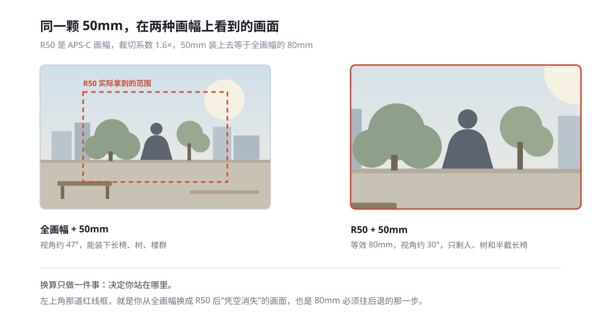
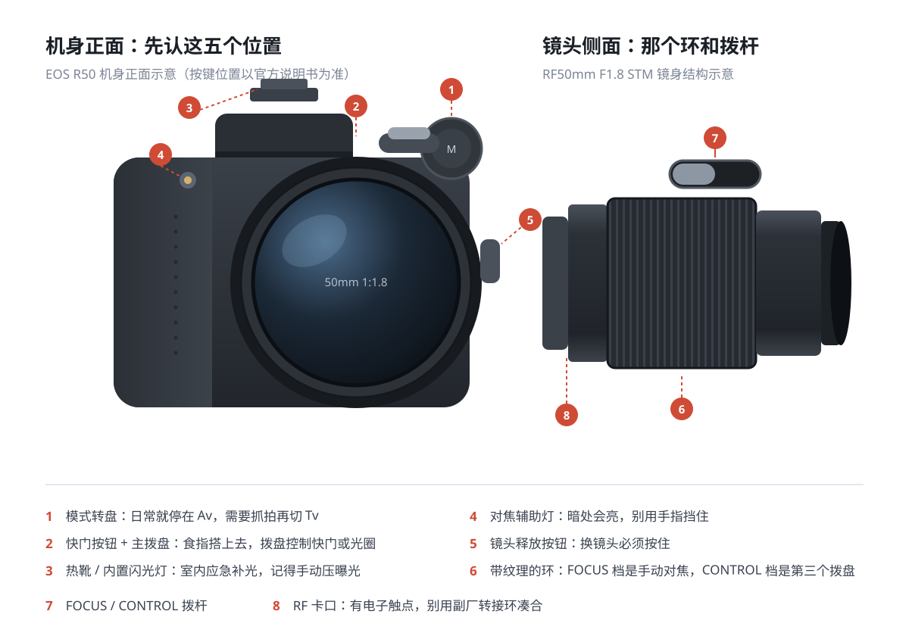
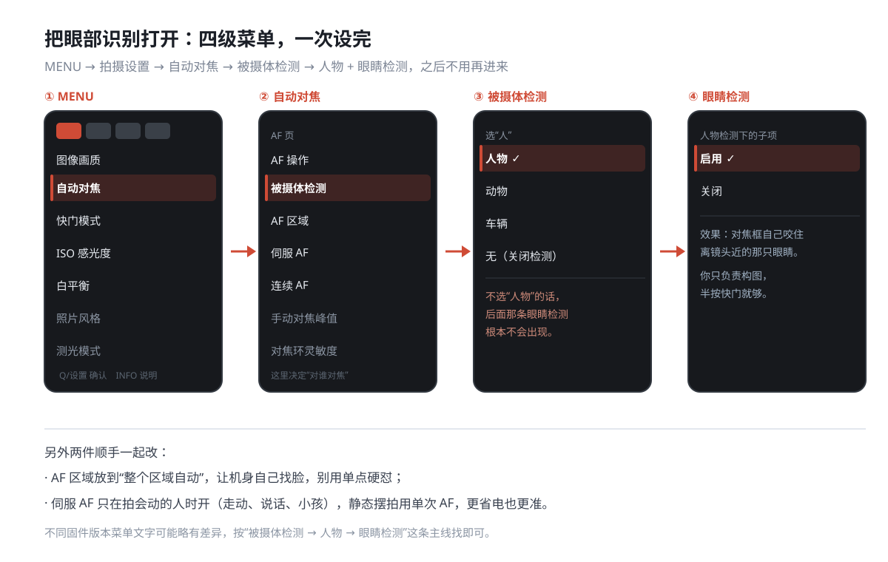
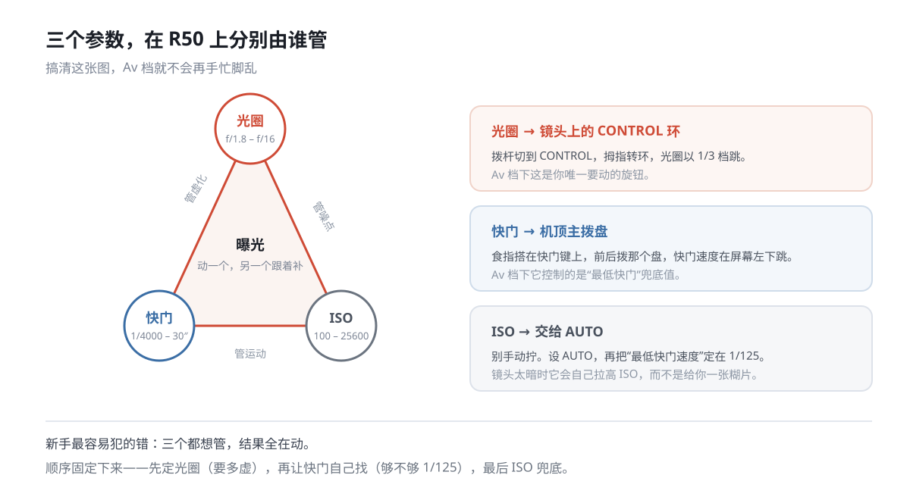
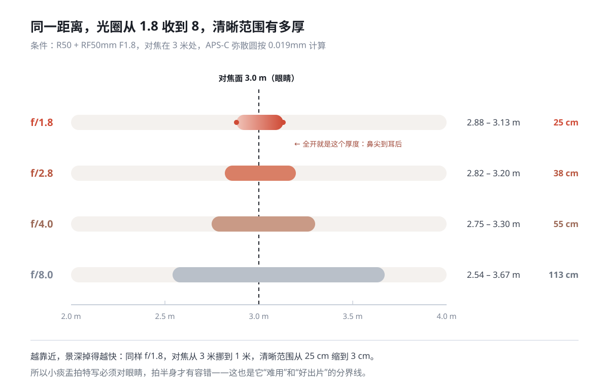
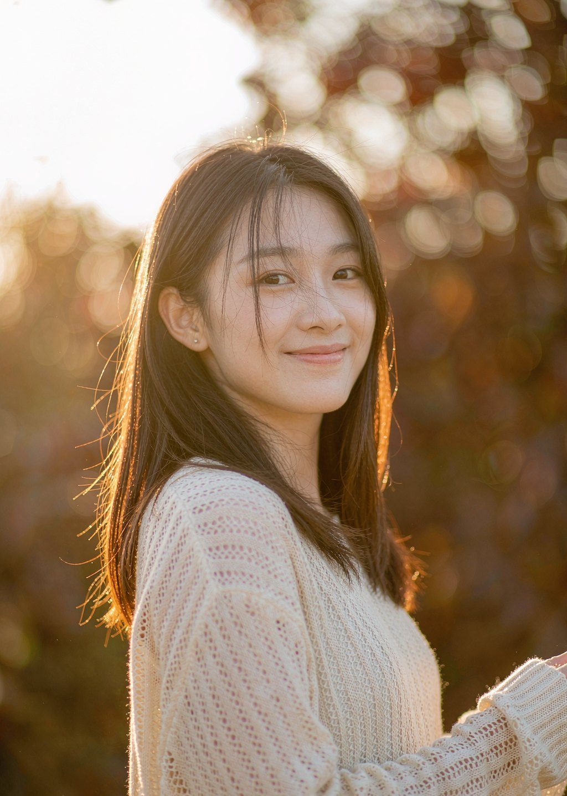
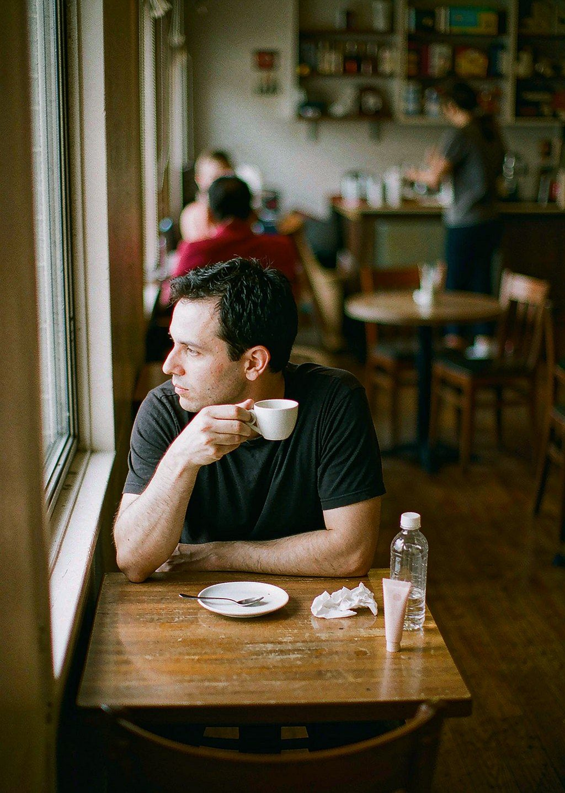
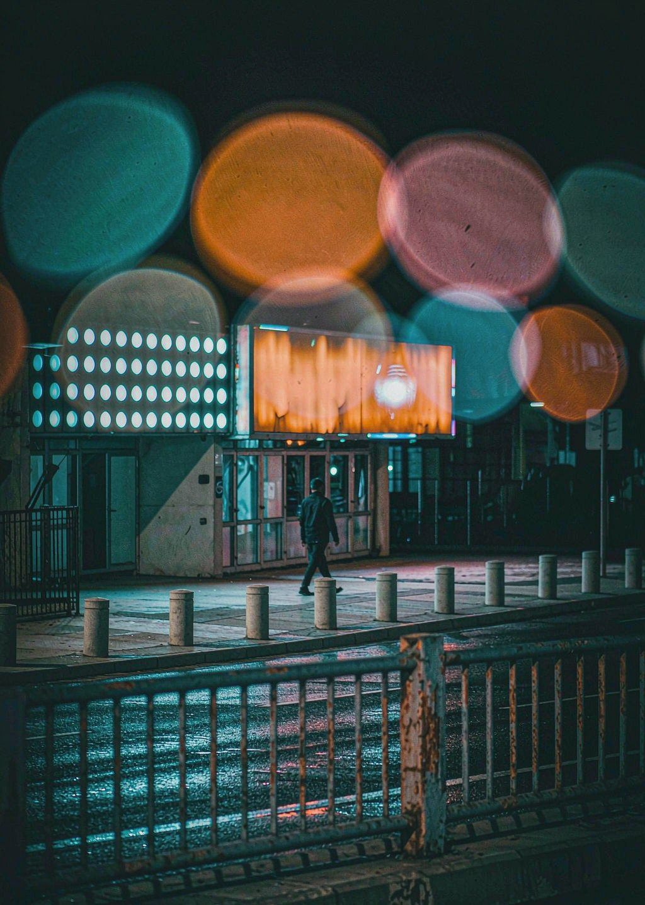
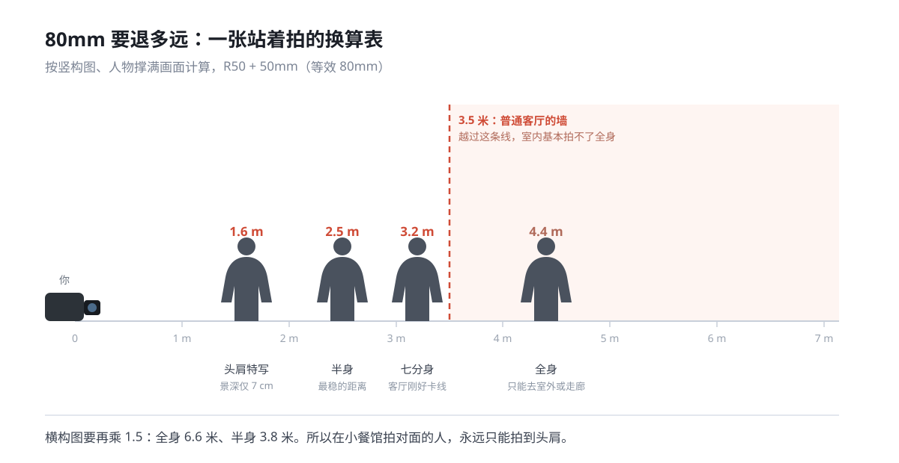
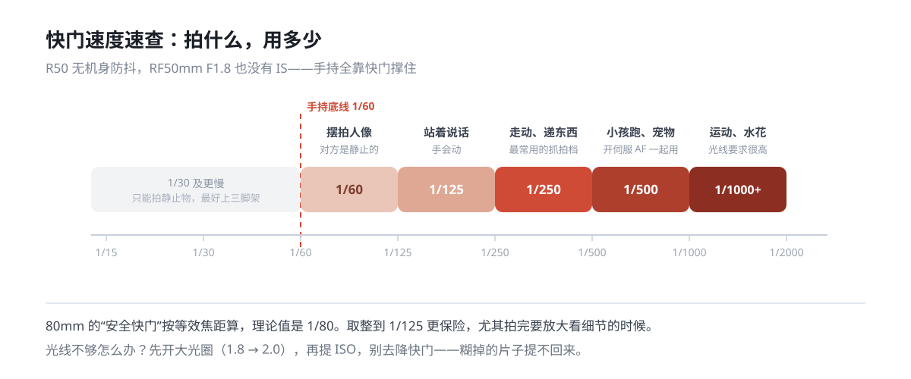

## 开篇：这颗镜头装在 R50 上，不是“50mm”

RF 50mm F1.8 STM 在全画幅机身上是标准的 50mm 视角。但 R50 是 APS-C 画幅，1.6 倍裁切系数之后，这颗镜头在 R50 上的等效焦距约为 **80mm**。

80mm 是一个很有意思的焦段。它比人眼视角略窄，比 85mm 人像镜略短，介于“观察”和“凝视”之间。用它拍半身像，透视自然，脸不会因为贴得太近而变形；用它拍特写，又比标准镜头多了一层把背景压下去的压缩感。但它也意味着一个初学者最容易忽略的变化：**你得往后退**。在室内拍全身，贴着墙大概率退不开；在小餐馆拍对面的人，80mm 的视角装不下整张桌子。

*左边是全画幅 50mm 看到的画面，红框是它在 R50 上实际留下的部分。换个说法：你花 50mm 的钱，买到了 80mm 的取景，也买到了 80mm 的后退距离。*

所以这篇教程不会一上来就列参数。先把机身和镜头上几个“不改就拍不顺”的地方定下来，再谈光圈和场景，最后给六个可以直接照着摆的场景配方。

## 一、先认清手里的两件东西

### 1.1 机身正面：先记住五个位置

R50 的机身按键不多，但每个都直接关系到出片。下面这张图把最常用的位置标了出来，后面所有操作都围绕它们展开。

| 位置 | 名称 | 你要用它做什么 |
| :--- | :--- | :--- |
| ① | 模式转盘 | 日常停在 **Av**，抓拍切 Tv，需要完全手动再进 M |
| ② | 快门按钮 + 主拨盘 | 食指搭上去，半按对焦、全按拍摄；拨盘改快门 |
| ③ | 热靴 / 内置闪光灯 | 内置灯是手动弹起的，GN 约 6，室内应急用 |
| ④ | 对焦辅助灯 | 暗光下自动亮，手指别压在上面 |
| ⑤ | 镜头释放按钮 | 换镜头必须按住它再逆时针拧 |

一个容易被忽略的点：R50 的内置闪光灯**不会自动弹起**，需要手动拨开关。很多人以为闪光灯坏了，其实是没打开。

### 1.2 镜头：三个物理结构决定手感

RF50mm F1.8 STM 的参数很朴素：5 组 6 片、7 片圆形光圈叶片、最近对焦 0.3 米、最大放大倍率 0.25 倍、滤镜口径 43mm、重量约 160 克。装到 R50 上整机不到 500 克，这是它真正被带出门的原因。

物理上只有三样东西值得记住：

1. **带竖纹的旋转环**：默认是手动对焦环，也可以改成控制环——这是本文第三节的主角。
2. **`FOCUS / CONTROL` 拨杆**：一个两档小开关，决定上面那个环干什么活。
3. **RF 卡口**：全电子触点，机内可以直接做周边光量、色差、衍射校正。别用杂牌转接环凑合，那些校正会失效。

0.3 米的最近对焦距离意味着：拍桌面上的咖啡杯、拍花、拍手部细节都够用，但**别指望拍微距**。想再近，只能加近摄接圈。

## 二、开机必改的七项设置

R50 的菜单层级不深，但默认状态里有几个地方会直接影响出片率。下面七项改完，后面的操作会顺很多。

### 2.1 图像画质：L + RAW

路径：`MENU → 拍摄设置 → 图像画质 → RAW + JPEG L`

只拍 JPEG 当然能出片，但小痰盂全开时边缘偏软，逆光还容易出色散。RAW 是 14 位，在 Lightroom 或 DPP 里收一下边缘、修一下紫边，比在 JPEG 上硬拉要从容得多。一张 RAW 约 25MB，一张 64G 卡能拍两千多张，够用。

### 2.2 对焦：被摄体检测设成“人物”，眼睛检测启用

这是 R50 最值钱的功能之一，但默认不一定开着。完整路径是四级：

`MENU → 自动对焦 → 被摄体检测 → 人物 → 眼睛检测：启用`

关键在第三级：**必须先选“人物”，眼睛检测这个子项才会出现**。很多人在这一层卡住，找不到“眼睛检测”，是因为被摄体检测还停在“无”。

小痰盂在 F1.8 下景深极薄——对焦在 2.5 米时清晰范围只有 17 厘米。如果没有眼部识别，半按快门稍微一偏，焦点就落到鼻尖或耳朵上了。开了眼睛检测，对焦框会自己咬住离镜头近的那只眼睛，你只需要构图。

### 2.3 AF 区域：整个区域自动

路径：`MENU → 自动对焦 → AF 区域 → 整个区域自动`

R50 的第二代全像素双核 AF 在检测到人物时，追踪范围能覆盖接近整个画面，机身会从 651 个分区里自己挑。新手用单点硬怼，十张里有三张会对到背景上去。

例外情况只有两个：**隔着玻璃拍**、**主体前面有走动的人**。这时切到“单点”或“定点”，把框放在脸上，更可靠。

### 2.4 ISO：AUTO + 最低快门 1/125

路径：`MENU → 拍摄设置 → ISO 感光度设置 → ISO 自动 → 最低快门速度 → 1/125`

R50 没有机身防抖，RF50mm F1.8 也没有 IS。手抖这件事只能靠快门兜住。80mm 的安全快门理论值是 1/80，取整到 1/125 更保险。

把 ISO 交给 AUTO，上限设 6400（再高噪点开始明显），然后**不要再去手动拧 ISO**。光线不够时它会自己拉高，而不是给你一张糊片。

### 2.5 快门方式：电子前帘

路径：`MENU → 拍摄设置 → 快门模式 → 电子前帘`

R50 提供两种：电子前帘（最高 1/4000）和电子快门（最高 1/8000）。日常用**电子前帘**，它有物理快门动作，拍移动的人不会有果冻效应，连拍也能到 12 张/秒。

两种需要切到电子快门的场合：正午大光圈需要 1/8000，或者在音乐会、图书馆要不打扰人。代价是果冻效应——拍快速横穿的物体时，竖线会歪。

### 2.6 屏幕亮度：往下调一档

路径：`MENU → 扳手 → 显示屏亮度 → 手动 → 调到 -1`

R50 的屏幕默认偏亮，室外看着“刚好”的照片，导到手机或电脑上往往偏暗一档。取景器同理，亮度调节也在同一页。这不是玄学——屏幕亮度和实际文件亮度不一致，你的曝光判断就永远差半档。

### 2.7 自动休眠：关掉，或设成 30 秒

路径：`MENU → 扳手 → 节电 → 自动关闭电源 → 关闭`

R50 从休眠唤醒需要零点几秒。街头、咖啡馆、朋友聚会这些“随时可能发生”的场景，错过的那一下往往就在唤醒的间隙里。关掉休眠，多带一块电池，比反复开关机划算。

**七项汇总：**

| 项目 | 设置 | 为什么 |
| :--- | :--- | :--- |
| 图像画质 | RAW + JPEG L | 给后期留余地 |
| 被摄体检测 | 人物 + 眼睛检测 | F1.8 下唯一的对焦保险 |
| AF 区域 | 整个区域自动 | 让机身自己找人脸 |
| ISO | AUTO，上限 6400 | 避免手抖糊片 |
| 最低快门 | 1/125 | 80mm 的安全底线 |
| 快门模式 | 电子前帘 | 无果冻效应，连拍 12fps |
| 屏幕亮度 | -1 | 让屏幕和文件一致 |
| 自动休眠 | 关闭 | 不放过任何一个瞬间 |

## 三、把镜头上的环变成第三个拨盘

RF50mm F1.8 STM 的镜身上有一个带纹理的环，侧面还有那个 `FOCUS / CONTROL` 拨杆。很多人把它留在 FOCUS 档，只在手动对焦时才转它。但在 R50 这种机身拨盘不多的机器上，**把它切到 CONTROL 档，是一个效率极高的隐藏操作**。

操作只有两步：

1. 把拨杆拨到 **CONTROL**；
2. 进 `MENU → 自定义功能 → 自定义控制环 → Av 档 → 光圈`。

设置完之后，在 Av 模式下：**拇指转镜头环改光圈，食指拨机顶盘看快门**。两个参数两个手指，眼睛不用离开取景器。这是小痰盂在 R50 上最被低估的价值。

几个实战细节：

- **步长选 1/3 档**。R50 支持 1/2 档和 1/3 档，1/3 档能从 F1.8 到 F2.0 到 F2.2 微调，这在小痰盂上很重要（F2.2 往往比 F1.8 更实用，后面会讲）。
- **CONTROL 档不影响自动对焦**。转环只改参数，不会跑焦，可以放心在 AF 模式下一直开着。
- **切回 FOCUS 的三个场景**：隔着玻璃拍、暗到 AF 拉风箱、前景有网或栏杆挡住主体。这时把拨杆拨回 FOCUS，用 `放大 5 倍 / 10 倍 + 对焦峰值` 手动对，比让机身瞎猜快。

手动对焦的辅助设置在 `MENU → 自动对焦 → 手动对焦峰值`（颜色建议选红色，最显眼）和 `对焦向导`。R50 的放大确认有 5 倍和 10 倍两档，拍静物时用 10 倍对在最前面的那条边缘上。

## 四、曝光：三个参数，各归谁管

Av 档的本质是：你决定光圈，机身决定快门，ISO 兜底。搞清这三个入口，就不会在拍摄时手忙脚乱。

**固定顺序，别乱：**

1. **先定光圈**——这张要多虚？想要背景化开就 F1.8–F2.2，想要环境和人都在就 F4–F5.6。
2. **再看快门**——半按快门，屏幕左下的快门值如果是 1/60 以下，说明光线不够，往后退一步或者换个角度。
3. **最后让 ISO 兜底**——已经设成 AUTO 了，它会自己顶上去。你只需要看 ISO 有没有超过 6400，超了就说明这个场景该补光了。

### 4.1 光圈不是越大越好

F1.8 全开是小痰盂的卖点，也是它最容易翻车的地方。全开时边缘偏软、色散明显、景深只有几厘米。真正好用的区间是 **F2.0–F2.8**：虚化还在，锐度和边缘明显好一档。

在 3 米处对焦，F1.8 的清晰范围是 2.88–3.13 米，只有 25 厘米——大概是从鼻尖到耳后的距离。收到 F2.8 变成 38 厘米，F4 是 55 厘米。**这就是为什么拍半身比拍特写容易**：距离一拉开，容错就来了。

而当你把对焦距离压到 1 米（拍脸的特写），F1.8 的清晰范围只剩 **3 厘米**。这时候眨眼、呼吸、身体前倾一点点，焦点就跑了。

### 4.2 光圈档位速查

| 光圈 | 虚化程度 | 适用 | 注意 |
| :--- | :--- | :--- | :--- |
| F1.8 | 最强 | 夜景、点光源散景、刻意柔化 | 边缘软、色散重、景深 3–25cm |
| F2.0–F2.2 | 很强 | **日常人像首选** | 锐度明显好转，虚化几乎无损失 |
| F2.8 | 中等 | 半身人像、双人合影 | 容错高，背景还能化开 |
| F4 | 较弱 | 带环境的人像、街拍 | 需要主体离背景足够远才有虚化 |
| F5.6–F8 | 几乎没有 | 静物、产品、需要全清晰的场景 | 衍射从 F11 开始明显 |

## 五、对焦：小痰盂的全部难点都在这里

### 5.1 半按快门重新构图，会跑焦

这是新手最常见的糊片原因。先对焦在眼睛上，然后半按着把相机转到构图位置——相机是绕着你的身体转的，焦平面跟着画了一个弧，原本合焦的眼睛就跑到焦平面前面去了。80mm 加 F1.8，这个误差足够让眼睛变虚。

三个解法，按推荐顺序：

1. **触屏拖拽 AF**：手指在屏幕上把对焦框直接拖到眼睛位置，不用转动机身。R50 支持这个功能，比摇杆快得多。
2. **先构图，再让眼睛检测自己找**：开了眼部识别之后，把脸放在画面想要的位置，半按，对焦框会自己跳过去。
3. **微调对焦框位置**：用方向键把 AF 框挪过去，再半按。

### 5.2 单次 AF 还是伺服 AF

- **单次 AF（ONE SHOT）**：对焦成功后锁定，适合摆拍、静物、风景。省电，也最准。
- **伺服 AF（SERVO）**：持续追焦，适合走动的人、小孩、宠物。配合连拍用。

R50 还有“人工智能自动对焦”，会自动判断主体动没动。听着省事，但切换的瞬间容易犹豫，拍人像时反而误事。**建议手动指定**，别交给 AI 猜。

### 5.3 对不上焦的五种情况

| 现象 | 原因 | 处理 |
| :--- | :--- | :--- |
| 拉风箱来回找 | 光线太暗或对比度太低 | 找有明暗交界的地方对，或切手动 |
| 一直对到背景 | AF 区域太大或主体太小 | 切单点，把框放脸上 |
| 对到眼镜框上 | 眼镜反光骗过了眼睛检测 | 稍微换个角度避开反光 |
| 隔着玻璃对不上 | 玻璃反射干扰 | 镜头贴紧玻璃，或切手动 |
| 拍完发现全虚 | 焦点落在鼻尖/耳朵 | 开眼睛检测，检查对焦框位置 |

## 六、六个场景的完整配方

下面每个场景都给出一套可以直接套用的参数，再说明为什么这么设。参数是起点，不是标准答案——光线变了就要动。

### 6.1 室外逆光半身像（傍晚）

*这张是 80mm 最典型的用法：主体在 2 米出头，背景的树被压成一片暖色光斑。*

| 项目 | 设置 |
| :--- | :--- |
| 模式 | Av |
| 光圈 | F1.8（想要更锐用 F2.2） |
| ISO | AUTO（通常落在 100） |
| 快门 | 相机决定，一般 1/1000 以上 |
| 曝光补偿 | **+0.7 到 +1.0** |
| 对焦 | 眼部识别 + 单次 AF |
| 白平衡 | 自动（氛围优先） |

**为什么要加曝光补偿**：逆光时评价测光会被背景的亮部带跑，把主体压成剪影。加 +0.7 到 +1.0，让脸回到正常亮度。R50 有“高光色调优先”，可以打开，天空不容易死白。

**站位**：让太阳在人物斜后方，你逆着光拍，头发会有一圈轮廓光。这时候镜头正对光源，**务必装上遮光罩**（选配），不然画面会发灰——小痰盂的镀膜扛不住直射光。

### 6.2 咖啡馆靠窗

| 项目 | 设置 |
| :--- | :--- |
| 模式 | Av |
| 光圈 | F2.0–F2.2 |
| ISO | AUTO（通常 400–1600） |
| 快门 | 保证 1/125 以上 |
| 曝光补偿 | +0.3 |
| 白平衡 | 自动（白色优先），后期再校 |

**80mm 在咖啡馆的真实处境**：对面坐一个人，你只能拍到胸口以上。想拍“人 + 咖啡 + 环境”，得退到 4 米开外——多数咖啡馆没有这个空间。所以这个场景的正确期待是**头肩和半身**，别硬要全身。

**用光**：让人侧对窗户，光从 45 度打过来。正对窗户会变成大平光，脸没了立体感；背对窗户则要靠反射光，脸会灰。F2 在这里比 F1.8 稳，因为桌面的杯子和手也需要一点清晰度。

### 6.3 夜景与点光源散景

| 项目 | 设置 |
| :--- | :--- |
| 模式 | Av |
| 光圈 | **F1.8（必须全开）** |
| ISO | AUTO，上限 6400 |
| 快门 | 1/60–1/80，靠栏杆或墙 |
| 曝光补偿 | **-0.7** |
| 对焦 | 单点，对在主体上 |

**散景怎么来的**：光圈越大，背景的点光源被虚化成越大的圆。想让光斑更圆更大，除了全开光圈，还要**让主体离背景足够远**——主体和背景的距离，至少是相机到主体距离的两倍。

**为什么要减曝光**：夜景里高光（灯牌、路灯）很容易过曝，减 -0.7 保住高光，暗部在 RAW 里还能拉回来。R50 的高感在 ISO 3200 以内都还算干净，6400 开始有可见噪点，但缩到网页尺寸基本看不出来。

**稳定**：R50 没有机身防抖，1/60 手持是小痰盂的物理极限。找栏杆、墙、桌面靠一下，比硬憋气有效。

### 6.4 桌面静物

| 项目 | 设置 |
| :--- | :--- |
| 模式 | Av |
| 光圈 | F2.2 |
| ISO | 800 |
| 快门 | 1/80 以上 |
| 对焦 | **单点 + 放大 10 倍手动微调** |
| 白平衡 | 自动，或按环境手动 |

0.3 米的最近对焦距离在这里很好用。**关键动作**：把对焦点放在最靠近你的那条边缘上（比如杯沿），而不是杯子的中心。因为景深只有几厘米，对在中心的话，靠近你的那半边会是虚的。

如果要拍“整桌都在清晰范围内”，光圈收到 F5.6，同时把相机稍微抬高一点，让桌面元素处在同一个焦平面上。

### 6.5 站多远：一张换算表

80mm 最大的现实问题是距离。下面这张图是按“竖构图、人物撑满画面”算出来的。

| 景别 | 竖构图距离 | 横构图距离 |
| :--- | :--- | :--- |
| 头肩特写 | 1.6 m | 2.4 m |
| 半身 | 2.5 m | 3.8 m |
| 七分身 | 3.2 m | 4.8 m |
| 全身 | 4.4 m | 6.6 m |

**这张表能解释很多“拍不出来”的抱怨**：在 3.5 米的客厅里，你最多拍到七分身；在人均 1.2 米宽的餐桌对面，你只能拍头肩。想拍全身，要么去室外，要么换 35mm 以下的镜头。

### 6.6 抓拍：快门速度给够

| 被摄体 | 快门下限 | 备注 |
| :--- | :--- | :--- |
| 静止摆拍 | 1/60 | 手持极限 |
| 站着说话 | 1/125 | 手部会动 |
| 走动、递东西 | 1/250 | 最常用的抓拍档 |
| 小孩跑、宠物 | 1/500 | 配合伺服 AF + 连拍 |
| 运动、水花 | 1/1000 以上 | 光线要够 |

Av 档下想强制一个更高的快门，有两个办法：**开大光圈**（F1.8 → 已经到底了），或者**提 ISO**。别去降快门——糊掉的片子提不回来。

## 七、糊片排查：先看这六条

| 症状 | 最可能的原因 | 一句话解决 |
| :--- | :--- | :--- |
| 整体都糊 | 快门太慢 | 保证 1/125 以上，或找支撑 |
| 眼睛虚、鼻尖实 | 焦点偏后 | 开眼睛检测，检查对焦框 |
| 一半实一半虚 | 主体不在焦平面上 | 收光圈到 F2.8 或调整站位 |
| 边缘发软、紫边 | 全开光圈 + 逆光 | 收到 F2.2，后期开色差校正 |
| 脸黄、肤色发闷 | 自动白平衡被环境带偏 | 切“白色优先”，或后期校 |
| 屏幕好看，电脑上偏暗 | 屏幕亮度太高 | 亮度调到 -1，看直方图 |

## 八、后期：三件事就够

小痰盂的 RAW 不需要大修，做这三件事就能提升一个档：

1. **开镜头校正**：Lightroom 的“启用配置文件校正”或 DPP 的“镜头像差校正”，勾上周边光量、色差、衍射。全开光圈的暗角和紫边基本一次解决。
2. **白平衡微调**：室内自动白平衡常偏黄。在色温滑块上往蓝色方向拉 200–400K，或者直接用吸管点一下白色物体。
3. **眼部局部提亮**：用蒙版圈住眼睛，加 0.2 档曝光、加点清晰度。80mm 的人像里，眼睛亮一点点，整个人的精神就出来了。

R50 机内也有“镜头像差校正”，拍 JPEG 时是自动生效的；拍 RAW 时，DPP 会读取这些数据，Lightroom 则需要自己勾配置文件。

## 九、速查卡

把这页存下来，出门前扫一眼。

| 场景 | 模式 | 光圈 | 快门 | ISO | 曝光补偿 |
| :--- | :--- | :--- | :--- | :--- | :--- |
| 室外逆光人像 | Av | F1.8–2.2 | 1/1000+ | AUTO | +0.7 |
| 咖啡馆半身 | Av | F2.0 | 1/125+ | AUTO | +0.3 |
| 夜景散景 | Av | F1.8 | 1/60–1/80 | AUTO(≤6400) | -0.7 |
| 桌面静物 | Av | F2.2 | 1/80+ | 800 | 0 |
| 全身人像 | Av | F2.8 | 1/250+ | AUTO | 0 |
| 抓拍小孩 | Tv | F1.8 | 1/500 | AUTO | 0 |

## 写在最后

小痰盂不是一颗“什么都能拍”的镜头。它挑场景：室内退不开、微距够不着、边缘全开会软。但它也有一种别的镜头给不了的东西——**它逼你决定**。

定焦没有变焦可以偷懒，你必须先想清楚“我要拍什么景别”，然后走过去。这个动作本身，比任何参数设置都更接近摄影的核心。R50 给了你足够好的对焦和一台愿意带出门的机身，小痰盂给了你 F1.8 和一整个 80mm 的视角。剩下的，只是多拍。
